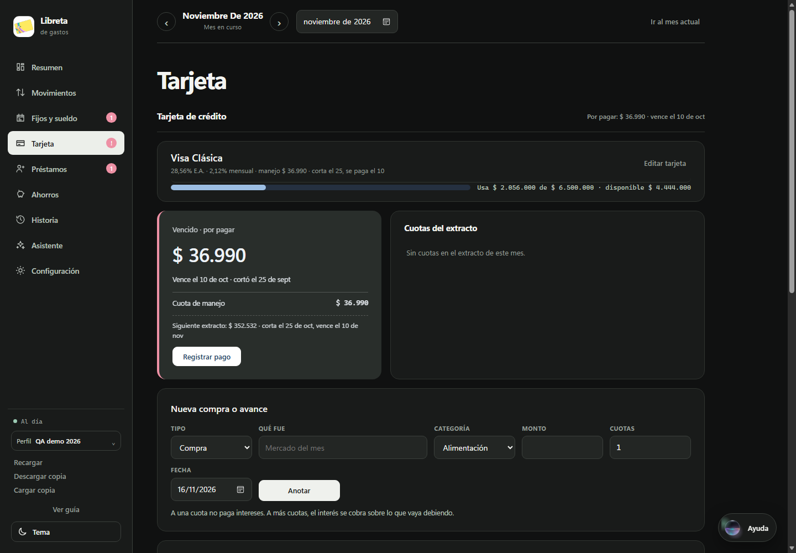

# Libreta de gastos

Aplicación de escritorio para Windows que reúne movimientos, presupuestos, tarjetas, préstamos y ahorros. Cada instalación crea su propia base SQLite local y cada perfil tiene su propia libreta. El asistente con OpenAI es opcional.


- **Resumen mensual.** Consulta el saldo disponible, los próximos pagos y la proyección del mes.
- **Guía por pestaña.** La primera visita muestra una introducción ilustrada y resalta los campos que se explican.
- **Ayuda contextual.** Explica campos sin clave. Con OpenAI configurado también consulta la libreta y prepara movimientos que se guardan al confirmarlos.
- **Copias de seguridad.** Descarga e importa copias JSON desde la app.

| Tarjeta | Guía interactiva |
| --- | --- |
|  |  |

[Ver la ayuda contextual en Tarjeta](docs/capturas/ayuda.png).

## Ejecutar desde el código

Desde PowerShell, ejecuta `python servidor.py` y abre la dirección local que aparece en la terminal. Para usar la ventana de escritorio, ejecuta `instalar.ps1` en Windows con Python y [Microsoft Edge WebView2 Runtime](https://developer.microsoft.com/microsoft-edge/webview2/) disponibles.

Para explorar la app, crea un perfil de prueba y usa **Cargar copia** con [demo/libreta-ficticia.json](demo/libreta-ficticia.json). La importación reemplaza los datos del perfil activo. El ejemplo está fechado en noviembre de 2026.

## Almacenamiento y privacidad

- La base `datos/gastos.sqlite3` se crea al abrir la app. El portable la crea junto al ejecutable. Si existe una libreta JSON de una edición anterior, el primer perfil puede importarla.
- SQLite y los respaldos JSON se guardan sin cifrar. El acceso a esos archivos depende de los permisos de Windows.
- La app guarda las claves configuradas por perfil en el Administrador de credenciales de Windows. Las consultas al asistente envían a OpenAI la pregunta y los datos que sus herramientas necesitan para responderla.
- Todas las capturas y el archivo de demostración usan datos ficticios.

Consulta la [guía de uso y del modelo de datos](LEEME.md) para conocer los cálculos y las secciones.

## Compilar para Windows

```powershell
powershell -ExecutionPolicy Bypass -File .\crear-portable.ps1
makensis "/DPORTABLE=$PWD\dist\Libreta de gastos" instalar-exe.nsi
makensis desinstalar-exe.nsi
```

Los dos últimos comandos requieren NSIS. Distribuye el instalador compilado a partir de un portable limpio. El desinstalador quita la instalación predeterminada de Documentos y su acceso directo, conservando los datos.

## Pruebas

```powershell
python -B -m unittest
node test_guia.js
node test_chat_contexto.js
node test_asistente.js
```

Las pruebas usan datos de prueba y no requieren una clave de OpenAI.
