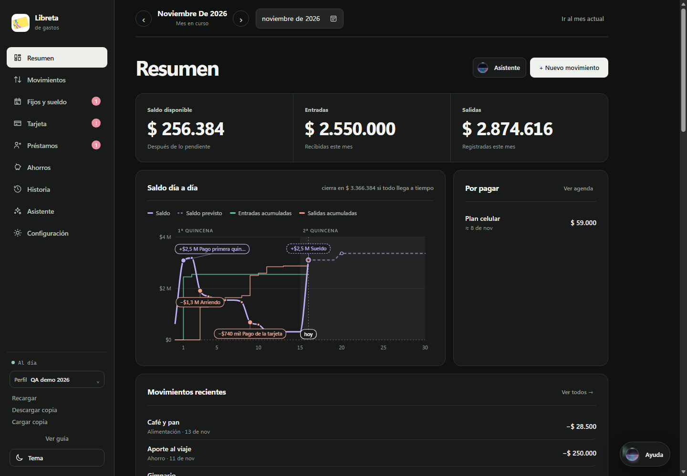
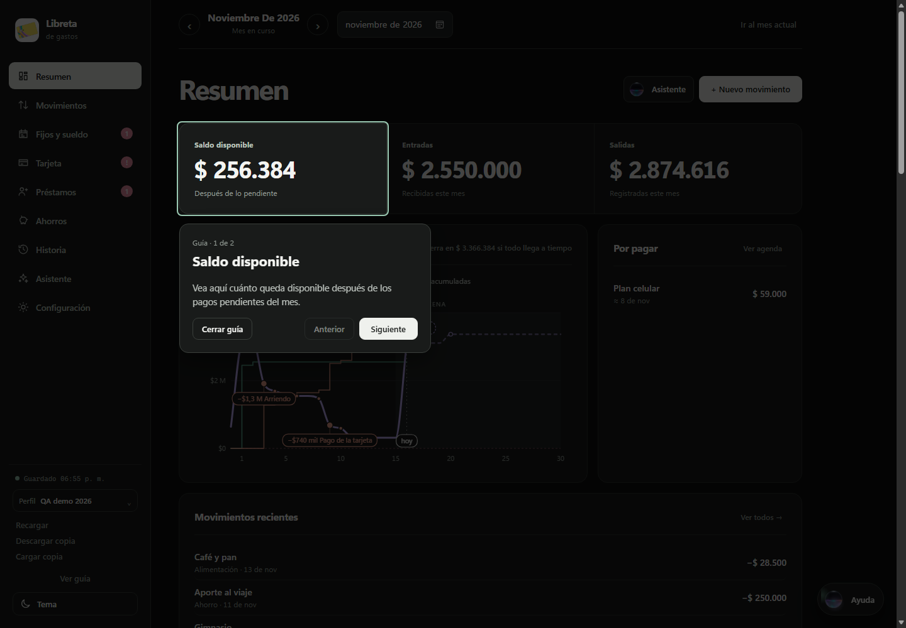
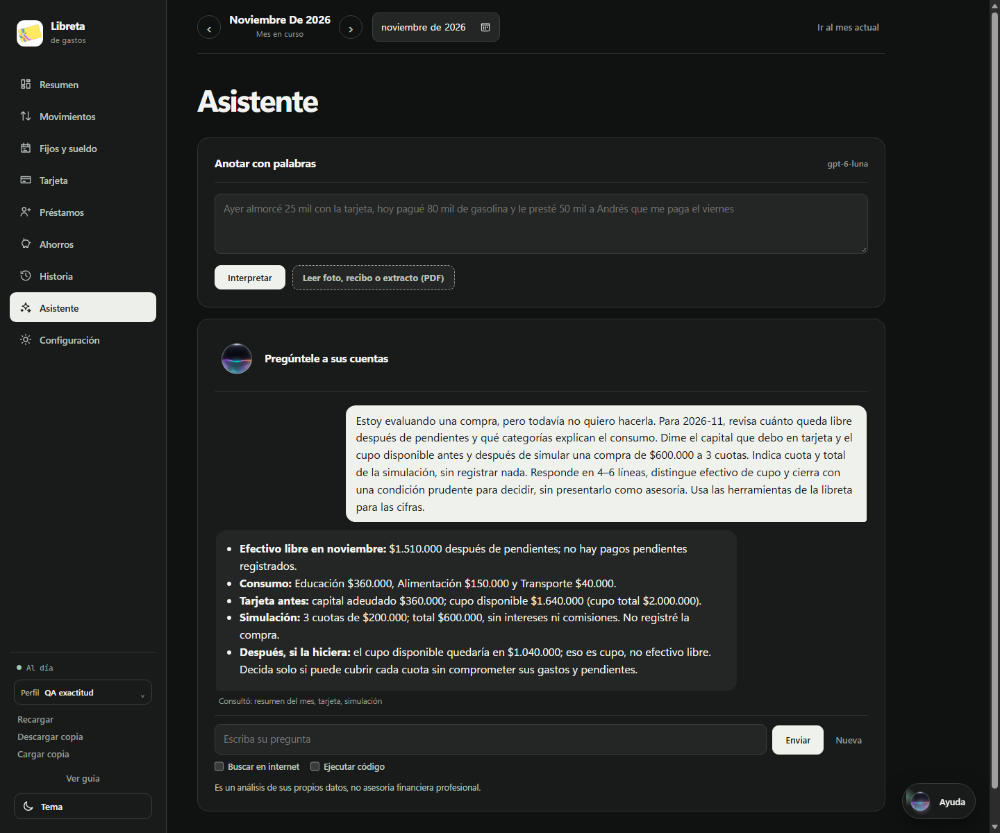

# Libreta de gastos

App de escritorio para Windows para gestionar movimientos, presupuestos, tarjetas, préstamos y ahorros. Cada instalación crea una base SQLite local. Incluye una guía por pestaña y un asistente de OpenAI opcional.



| Tarjeta de crédito | Guía interactiva |
| --- | --- |
|  |  |

## Ejemplos del asistente

**Explicar un campo.** Desde Tarjeta, abre **Ayuda → Preguntar al asistente**. Si preguntas «¿Qué significa cupo?», el asistente usa el contexto de Tarjeta para explicar que es el límite de crédito.

**Evaluar una compra.** En la captura, el asistente revisa cuánto efectivo queda, desglosa el consumo por categoría y distingue la deuda del cupo disponible. Después simula una compra ficticia de 600.000 COP a tres cuotas y muestra que el cupo pasaría de 1.640.000 a 1.040.000 COP. La simulación no crea ningún movimiento.

**Proponer un movimiento.** Si escribes «Anota 13.000 pesos de café», el chat presenta una propuesta editable. El gasto se guarda cuando pulsas **Anotar 1 movimiento**.



## Ejecutar

En PowerShell, ejecuta `python servidor.py` y abre la dirección local. Para crear un acceso directo a la versión de escritorio, ejecuta `instalar.ps1`. La ventana de escritorio usa Microsoft Edge WebView2.

## Compilar para Windows

```powershell
powershell -ExecutionPolicy Bypass -File .\crear-portable.ps1
makensis "/DPORTABLE=$PWD\dist\Libreta de gastos" instalar-exe.nsi
makensis desinstalar-exe.nsi
```

Los dos últimos comandos requieren NSIS. Compila el instalador a partir de un portable limpio, antes de abrirlo con datos personales.

## Datos

La app crea `datos/gastos.sqlite3` al arrancar. El asistente se configura por perfil y la clave se guarda en el Administrador de credenciales de Windows. Al consultar al asistente, la pregunta y los datos necesarios para responderla se envían a OpenAI.
